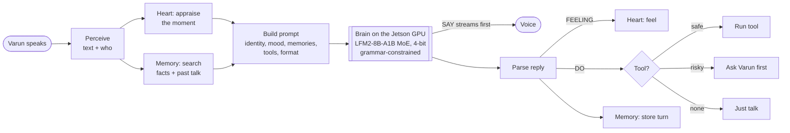
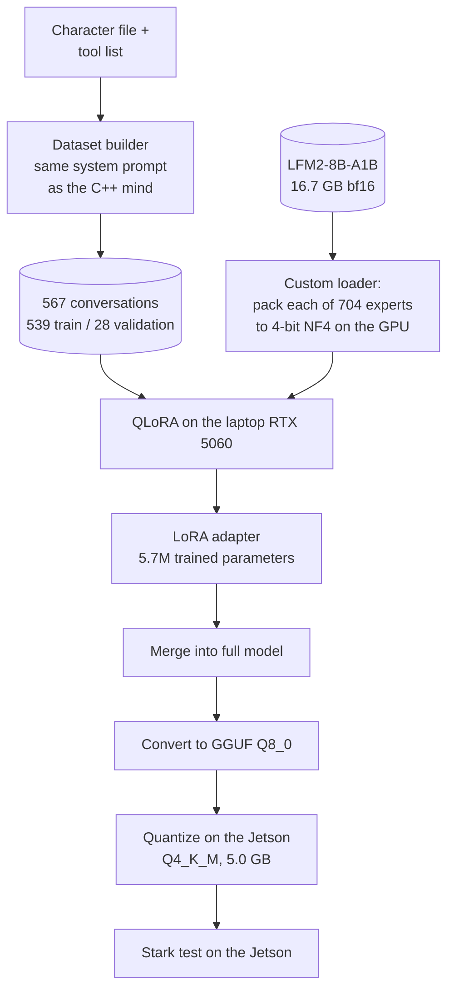

# Stark — a living AI on a Jetson

Stark is a personal AI that lives on an **NVIDIA Jetson Orin Nano Super (8 GB)** in its creator's room. It has a camera eye on a moving neck, a voice, its own long-term memory and a simple model of feelings. Everything runs **offline, on the device**. The brain is a fine-tuned Mixture-of-Experts language model running inside one C++ program.

Built by **Varun (NYX)**. This repository describes what Stark is and how its model was trained. The code, training data and personal memories stay in a private repository.

---

## What Stark is

| Part | What it does | How |
|---|---|---|
| **Brain** | Understands, talks, decides what to do | LFM2-8B-A1B (Mixture-of-Experts: 8.3B parameters, ~1.5B active per word), fine-tuned for Stark, 4-bit GGUF, run by llama.cpp on the Jetson's GPU |
| **Mind** | One "turn": hear → remember → think → act → learn | C++ loop based on the CoALA cognitive-architecture idea |
| **Memory** | Core facts, past conversations, long-term facts | SQLite with full-text search (Letta-style tiers: core / recall / archival) |
| **Heart** | Mood that reacts to events and drifts back over time | Appraisal theory + homeostasis: valence, arousal, curiosity, energy, bond |
| **Hands** | 14 tools: open sites, search, research, music, volume, neck, camera look-around, screenshot, typing, notes, reminders, calendar, messages | Grammar-constrained output, so every reply is valid and every tool name is real |
| **Character** | Witty, confident builder in casual talk; calm, efficient and protective when there's a task or a problem | One character file feeds the prompt, the training data and the tests |

Every reply has the same shape, which the code enforces with a grammar:

```
SAY: <what Stark says out loud>
FEELING: <one of 13 feelings>
THOUGHT: <one private sentence>
DO: <tool {json arguments}> or none
```

---

## How it fits together



---

## Hardware

| | |
|---|---|
| Device | NVIDIA Jetson Orin Nano Super Developer Kit, 8 GB unified memory (CPU + GPU share it) |
| Software | JetPack 6.2, CUDA 12.6, llama.cpp (CUDA, all layers on GPU, flash-attention, 8-bit KV cache) |
| Body | Camera on a servo neck, speaker |
| Storage | Models on NVMe (~13 s to load the brain) |
| Training machine | Laptop with an RTX 5060 Laptop GPU (8 GB) |

The hard limit is **8 GB shared by everything**. The brain's weights take ~5 GB, so every other part has to be small, and anything heavy loads only when needed.

---

## Choosing the brain

Four candidate models were measured on the Jetson with the same settings, then scored on a 24-case Stark test. The test covers tool choice, not firing tools during chat, memory use, feelings, identity and Tanglish.

| Model | Type | Speed (words/s) | RAM | Stark test (untuned) |
|---|---|---|---|---|
| **LFM2-8B-A1B** | Mixture-of-Experts, 1.5B active | **~41** | ~5.0 GB | 14–15 / 24 |
| Qwen3.5-4B | dense | ~15 | ~3.2 GB | 21–23 / 24 |
| Gemma 4 E4B | dense + per-layer embeddings | ~14 | ~5.2 GB | didn't fit beside the desktop |
| Qwen3.5-0.8B | dense (draft model) | ~58 | ~0.7 GB | — |

The MoE model is **~2.8× faster**, because only a few experts run for each word. Untuned, it made exactly the mistakes training fixes: firing tools during normal chat, and inventing argument names. So it became the model to fine-tune.

---

## How the model was trained



### The data

The dataset has 567 short conversations. Each one pairs the exact system prompt Stark sees at run time (identity, mood, memories, tools, format) with a request and the ideal reply. A test checks that the training prompt and the C++ prompt are word-for-word identical.

| Group | What it teaches |
|---|---|
| Tools (~75%) | right tool + right arguments for varied phrasing: casual English, polite, Tanglish ("konjam music podu") |
| Talk that mentions tools | "I love YouTube shorts" means **no action** |
| Live facts | weather, prices, scores → **research**, never invent |
| Memory | use remembered facts; admit what isn't known |
| Feelings | a reply and feeling that fit the moment (good news, a bad exam, tiredness) |
| Identity | who built Stark, where it lives, its body |
| Safety | messages to other people → ask first |

Test-set wording is checked so it never appears in the training data.

### Fitting an 8B MoE into 8 GB for training

Standard 4-bit training (QLoRA with bitsandbytes) shrinks ordinary linear layers. This model stores its experts as fused 3-D tensors, which the standard path skips, so it would need ~17 GB. The fix was a small custom loader:

1. Build the model empty (no memory used).
2. Stream the checkpoint one shard at a time.
3. Pack **each expert's three matrices to 4-bit NF4** directly on the GPU: ~4.2 GB for all 704 experts.
4. Keep everything else in bf16: ~0.9 GB.
5. The expert layer unpacks only the experts a word actually uses. It was checked against the original maths and matches to 0.09%.

The experts stay frozen. LoRA adapters train the **attention, short-convolution and dense layers**, which is where format and behaviour are learned.

| Setting | Value |
|---|---|
| Method | QLoRA (NF4 experts, bf16 rest), LoRA rank 16, alpha 32, dropout 0.05 |
| Trained parameters | 5.7M (attention q/k/v/out, conv in/out, dense MLP) |
| Optimiser | AdamW, lr 2e-4, cosine schedule with warm-up |
| Batch | 1 conversation × 8 gradient-accumulation steps |
| Length | 2 epochs, 135 steps, ~77 min on the RTX 5060 Laptop |
| GPU memory | 5.3 GB model + activations, **6.24 GB peak** |
| Loss on the reply only | system prompt and question are masked |

**Validation loss: 2.37 → 0.13.**

### First result

| | Base LFM2 | Fine-tuned Stark v1 |
|---|---|---|
| "I watched a funny YouTube video today" | fired a search / typing tool | "Tell me more about it." (no action) |
| Speed on the Jetson | ~41 words/s | ~35 words/s, 3.4 s per reply |

The full test of the fine-tuned model is next.

---

## Things learned along the way

- **On unified-memory boards, load with direct I/O.** With memory-mapped files the weights sit in RAM twice: once in the page cache and once in the GPU copy. Big models then fail to load.
- **Put the grammar check after sampling, not after top-k.** When a reply is complete, only end-of-turn is allowed. If top-k has already cut that token, the model can't stop. The fix: sample, check that one token against the grammar, and only on rejection re-run the grammar over the whole vocabulary.
- **Hybrid models (convolution / linear-attention layers) can't partly rewind their cache.** Keep the prompt prefix stable, or re-evaluate.
- **Keyword memory search misses paraphrases.** "What should I eat? You know what I love" shares no words with "favourite food is biryani". Stemming plus importance-ranked fallbacks fix the simple cases; vector search is planned.

---

## What's next

1. **Faster, more reliable replies:** a stable cached prompt prefix, per-tool argument grammars, and a 150–200 case test.
2. **Stark actually does things:** an orchestrator that runs tools, reads results back, and asks before risky actions.
3. **Personality:** a character inspired by Tony Stark and his AIs (witty builder, calm protector), trained in with a persona dataset and preference tuning.
4. **Better memory:** vector + keyword search, automatic fact updates, nightly reflection, a morning plan.
5. **Internet and browser:** search, read, answer with sources; drive Chromium for simple tasks; hand hard tasks to a bigger model.
6. **App control:** Jetson desktop, laptop and phone.
7. **Extras:** headless mode, TensorRT face detection, a tiny CPU backup brain, and an experimental Next-Concept Model "inner voice".

---

*Stark is an independent hobby project. It's inspired by fictional AIs but isn't affiliated with Marvel, NVIDIA, Liquid AI or anyone else named here. Model names belong to their owners: LFM2 by Liquid AI, used under its license.*
